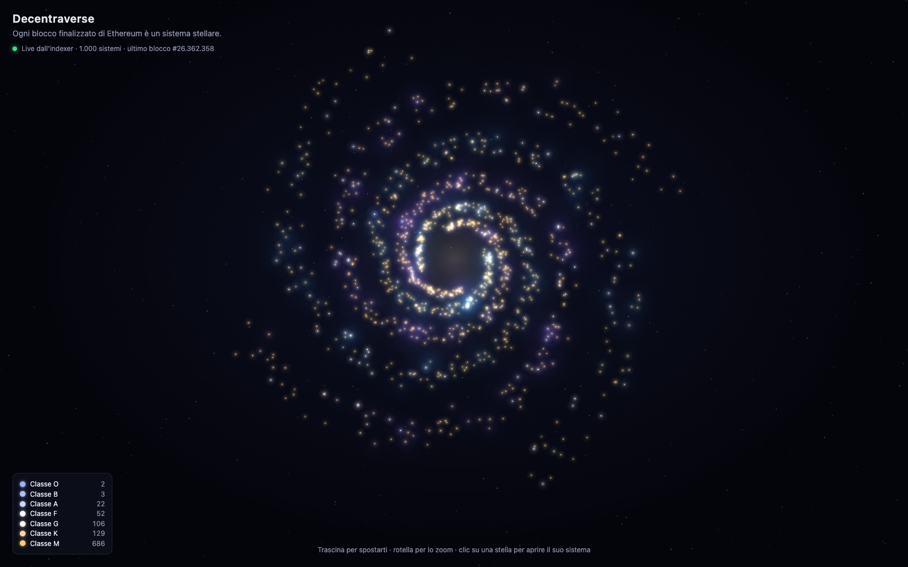
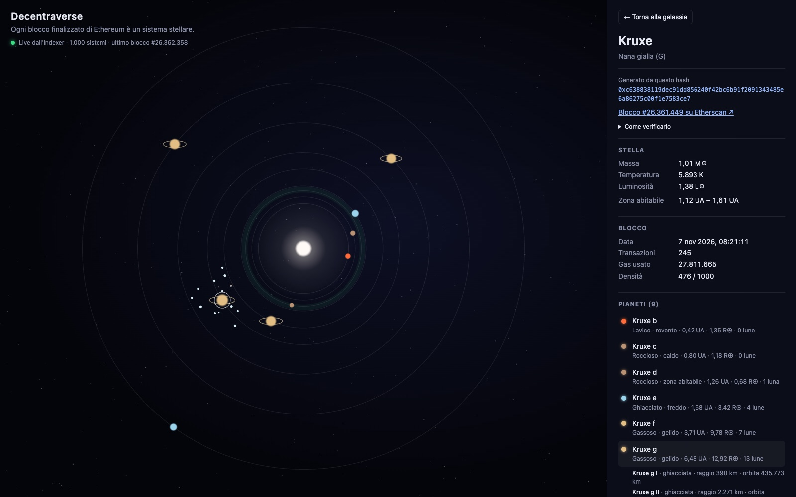
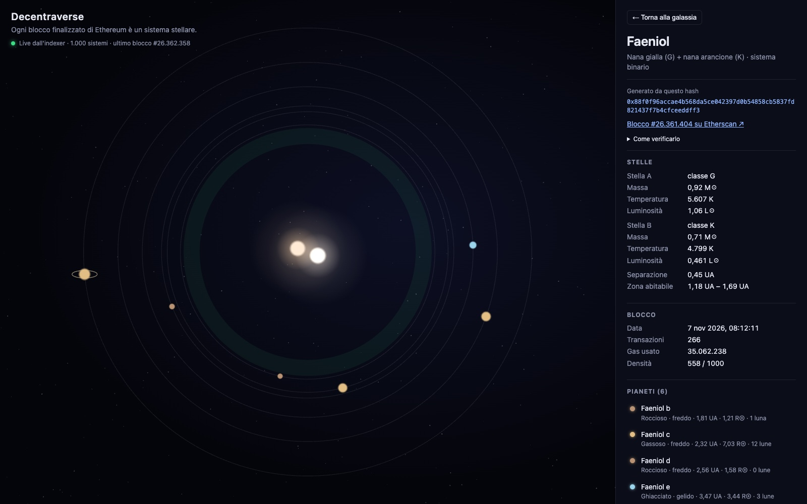
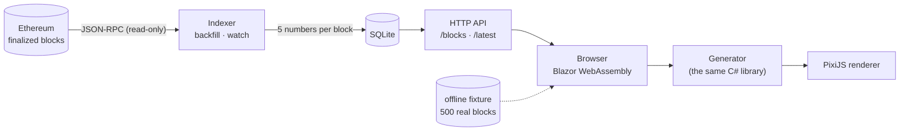

# Decentraverse

**A procedural universe written by the Ethereum blockchain.**



> **Every finalized Ethereum block becomes a star system. Its hash is the seed of a deterministic generator.**
> **Anyone who runs the generator on the same block gets exactly the same stars, planets and moons, on any machine.**
> **Nothing is stored anywhere: the universe is rebuilt from the chain, and it grows by one system every 12 seconds.**

Nobody designs these worlds and nobody can pick them. Each one comes from a 256-bit block hash that no one could predict or choose in advance. Every system can be **verified**: the panel next to each star shows the hash it came from, and two shell commands are enough to recompute its seeds.

The chain is used **read-only**, as a public source of verifiable randomness. There are no wallets, tokens, NFTs or smart contracts.

---

## Contents

- [Try it in two minutes](#try-it-in-two-minutes)
- [A tour of the app](#a-tour-of-the-app)
- [How it works](#how-it-works)
- [Verify a system by hand](#verify-a-system-by-hand)
- [Probabilities and generation rules](#probabilities-and-generation-rules)
- [The indexer](#the-indexer)
- [Tests: the guarantees](#tests-the-guarantees)
- [Project structure](#project-structure)
- [Design decisions](#design-decisions)
- [Roadmap](#roadmap)

---

## Try it in two minutes

**Requirements:** the [.NET 10 SDK](https://dotnet.microsoft.com/download). You don't need Node or npm, an account, or a wallet.

**1. Index the last 1,000 finalized blocks.** This takes about 15 seconds, using a free public endpoint by default:

```bash
dotnet run --project src/Decentraverse.Indexer -- backfill --count 1000
```

**2. Start everything:**

```bash
./dev.sh
```

**3. Open http://localhost:5080.** That's it.

`dev.sh` runs the indexer API, which keeps polling for new finalized blocks, together with the web app. Ctrl+C stops both. Leave it open and new stars will keep appearing on the rim of the galaxy.

**Just want to look around?** Run the web app alone. If no indexer answers, or the database is still empty, it switches to an **offline mode** with 500 real blocks bundled in the app:

```bash
dotnet run --project src/Decentraverse.Web
```

**Your own RPC endpoint (optional).** Copy `.env.example` to `.env` and set `ETH_RPC_URL`. An Infura or Alchemy free tier is plenty: the indexer makes roughly 10,000 requests a day. `.env` is git-ignored, and the indexer never prints the URL, because it contains your key.

---

## A tour of the app

### The galaxy

Each dot is a real, finalized Ethereum block.

- **Color** is the spectral class: blue O and B giants, white A and F stars, yellow G (like the Sun), orange K, and the red M dwarfs that make up most of the galaxy.
- **Size** grows with the star's mass.
- **Black holes** are a dark core inside an orange accretion ring. They are rare enough to be events: about one every 9 days of chain time.
- **Binary stars** carry a small companion dot.
- **Nebulae** glow around blocks that were close to full (high gas and transaction count), so busy periods on the chain show up as clouds.
- **The galaxy grows outwards.** It is a four-armed logarithmic spiral that starts at [The Merge](https://ethereum.org/en/roadmap/merge/), the first block that could ever be finalized. Older blocks sit towards the core. Roughly every 6.4 minutes the chain finalizes a new epoch of 32 blocks; their stars **appear on the rim with a small birth animation**, and the rest of the galaxy shrinks slightly to make room.
- Drag to pan, scroll to zoom, hover a star for its name, block and class, and click it to open the system.

The legend counts the classes currently on the map. A green dot means live data from the indexer; an orange dot means the offline fixture.

### A star system



This is **Kruxe**, block [#26,361,449](https://etherscan.io/block/26361449): a yellow G star a little hotter than the Sun, with nine planets.

- **The habitable zone** is the faint green band, computed from the star's luminosity. *Kruxe d* sits in it: a rocky world with one moon.
- **The orbits** follow a noisy Titius–Bode progression, like the Solar System's.
- **Planet type depends on the zone:** lava worlds close to the star, rocky worlds in the warm band, ice and gas giants beyond the frost line. Big gas giants get rings.
- **Planets really orbit,** with Kepler-like speeds: inner planets run, outer giants crawl.
- **Moons are generated only when you ask for them.** Click a planet, on the map or in the panel, and its moons are created on the spot, each from its own seed. Here *Kruxe g*, a gas giant, has 13 of them.
- **The side panel** shows the star's mass, temperature and luminosity, plus the block's date, transactions, gas and density. It also shows the **hash the system was generated from**, a link to the block on Etherscan, and the exact seeds to check it yourself.

### A binary system



About **one block in 32** produces a close binary. In *Faeniol* (block [#26,361,404](https://etherscan.io/block/26361404)) a yellow G star and an orange K star circle each other. The planets are **circumbinary**: they orbit both stars, and none may come closer than three times the separation between them. Star A is always the more massive one.

### Shareable links

Every view has its own URL. Open the system above with `http://localhost:5080/#/block/26361404`, or open Kruxe with its giant already selected with `/#/block/26361449/planet/5`. Blocks that are not on the map are fetched from the indexer.

---

## How it works



| Part | What it does |
|---|---|
| **Generator** (`src/Decentraverse.Generator`) | A pure, deterministic library: block in, star system out. No I/O, no clock, no randomness, no floating point. This is the heart of the project. |
| **Indexer** (`src/Decentraverse.Indexer`) | Reads **finalized** blocks from an Ethereum node, stores `number, hash, timestamp, txCount, gasUsed` in SQLite and serves them over HTTP. **It never stores a generated system**: systems are always recomputed. |
| **Web** (`src/Decentraverse.Web`) | Blazor WebAssembly. The browser runs **the very same C# generator**: there is no JavaScript port to keep in sync. PixiJS only draws what C# computed. |

### From a block hash to a star system

**1. Normalize the hash.** It is always `0x` plus 64 lowercase hex digits. `0xABC…` and `0xabc…` are the same block, but as text they would give different seeds.

**2. Derive hierarchical seeds.** The block hash is never used directly. Each part of the system gets its own SHA-256 seed:

```
star seed    = SHA-256("v1:<hash>:star")
rare seed    = SHA-256("v1:<hash>:rare")
planet i     = SHA-256("v1:<hash>:planet:<i>")
moon j of i  = SHA-256("v1:<hash>:planet:<i>:moon:<j>")
```

Separate seeds mean you can generate only what you need. A moon can be computed without touching any other moon, and changing how moons are generated cannot affect stars or planets.

**3. Rare events from bit patterns.** These are read directly from the rare seed, so their odds are exact and you can check them by eye:

- black hole if the seed starts with `0000` (1 in 65,536);
- close binary if the low 5 bits of its third byte are zero (1 in 32).

**4. Roll the dice.** The first 16 bytes of a seed, read as four little-endian `uint32`, initialize [**xoshiro128\*\***](https://prng.di.unimi.it/), a small, fast and well-studied PRNG. Every decision is an integer draw from it: `NextBelow(100000)` picks the spectral class, `NextChance(1, 4)` is true with probability exactly 1/4. Draws use rejection sampling, so there is no modulo bias.

**5. Build the system,** always in the same order:
1. the name (2–4 pronounceable syllables);
2. the spectral class;
3. the star's position within its class, which sets mass, temperature and luminosity together so they stay consistent;
4. the companion star, if the system is a binary;
5. the number of planets;
6. then each planet from its own seed: orbit, zone, type, radius, moon count.

**The order of draws is part of the rules.**

### The rules that make it trustworthy

- **Integers only.** Transcendental functions (`sin`, `exp`, `log`, `pow`…) can differ in the last digit between runtimes and languages. One different digit can flip a decision, and then the universe is no longer the same for everyone. So the generator uses no floating point at all:
  - every quantity is a fixed-point integer (distances in micro-AU, masses in milli solar masses…);
  - even the habitable zone's square root is an exact integer algorithm.

  A test **scans the generator's source code** and fails if it finds `double`, `Math.Sin`, `Random`, `DateTime` or file access. The only exempt folder is `Rendering`, which decides *where* to draw, never *what* exists.
- **Versioned rules.** `GeneratorInfo.Version = "v1"` is part of every seed. Changing any rule (a table, a formula, the order of draws) means bumping the version, which yields a *new*, declared universe. The universe never changes silently, and a **golden test** on five real mainnet blocks enforces it.
- **Finalized blocks only.** For a few minutes a recent block can still be replaced (a *reorg*). Finalized blocks cannot. A star you see will never disappear.

### Laying out a galaxy that grows forever

A naive spiral has a problem. With millions of blocks, the latest thousand would form a thin ring at the very edge. Decentraverse uses a **logarithmic spiral**, which looks the same at every zoom level:

- block *n* (counted from the Merge) goes to arm `n mod 4`, at step `n / 4` along it;
- each step turns the arm by 2π/200 and scales the radius by a constant factor, so one full turn is 800 blocks, about 2.7 hours of chain time;
- the newest block is drawn at a fixed radius and everything older spirals inwards;
- a little jitter, taken from bytes 16–19 of the star seed (which the PRNG never reads), keeps the arms organic.

Every star has a permanent place in the spiral. A new block only rescales the picture.

---

## Verify a system by hand

You don't have to trust this repository, its database, or its screenshots. Here is the first proof-of-stake block, [#15,537,394](https://etherscan.io/block/15537394), the block of The Merge.

**1. Take the block hash from any source you trust,** for example Etherscan:

```bash
HASH=0x56a9bb0302da44b8c0b3df540781424684c3af04d0b7a38d72842b762076a664
```

**2. Compute the seeds with any SHA-256 tool:**

```bash
printf '%s' "v1:${HASH}:star" | shasum -a 256
# a18f0b3897dd309275ecf47f52abe423d9ec0943471755185533163cf057c050

printf '%s' "v1:${HASH}:rare" | shasum -a 256
# 05a24cbb8b688f8d5353cda3752378626f19ec14501424f23afd1150a638d7be
```

**3. Read the rare events:**
- the rare seed does not start with `0000`, so this is **not a black hole**;
- its third byte is `0x4c`, and `0x4c & 0x1f = 0x0c`, which is not zero, so this is **not a binary**.

**4. Initialize the PRNG** from the first 16 bytes of the star seed, read as little-endian words:

```
a18f0b38 97dd3092 75ecf47f 52abe423
s0 = 0x380B8FA1   s1 = 0x9230DD97   s2 = 0x7FF4EC75   s3 = 0x23E4AB52
```

From here every draw is plain integer arithmetic (see [`Xoshiro128StarStar.cs`](src/Decentraverse.Generator/Xoshiro128StarStar.cs), a line-by-line translation of the authors' C code).

**5. Or let the tool print everything:** the block, the exact seed inputs and their hashes, and the full system.

```bash
dotnet run --project src/Decentraverse.Indexer -- system --number 15537394 --moons
```

Either way, the result is **Shagonelax**:
- a red dwarf of 0.145 M☉ and 2,631 K, with its habitable zone at 0.116–0.168 AU;
- nine planets: three lava worlds, then gas giants and an ice giant out in the cold.

The same answer is pinned in [`Golden/v1.json`](tests/Decentraverse.Generator.Tests/Golden/v1.json), so `dotnet test` catches any drift.

In the app, the "Come verificarlo" (*how to verify it*) section of each system's panel shows the same command and seeds. The interface is in Italian; the code and docs are in English.

---

## Probabilities and generation rules

All odds below are **exact by construction**: they come from integer weights, not from tuning.

### Rare events

| Event | Rule | Probability | On mainnet (≈7,200 blocks/day) |
|---|---|---|---|
| **Black hole** | rare seed starts with `0000` (16 zero bits) | 1 / 65,536 ≈ 0.0015% | about one every **9 days** |
| **Close binary** | low 5 bits of the rare seed's 3rd byte are zero, and not a black hole | 1 / 32 ≈ 3.1% | about **225 a day** |
| **O-class blue giant** | 50 / 100,000 per star | 0.05% | about **3–4 a day** |

A black hole has a mass of 5–30 M☉ and, in v1, no planets.

### Spectral classes

The distribution is "playable" rather than strictly realistic. In the real galaxy an O star is about 1 in 3 million, too rare to ever be seen. The shape is realistic, though: red dwarfs dominate.

| Class | Weight | Mass (M☉) | Temperature (K) | Luminosity (L☉) |
|---|---|---|---|---|
| O | 0.05% | 16 – 60 | 30,000 – 50,000 | 30,000 – 1,000,000 |
| B | 0.45% | 2.1 – 16 | 10,000 – 30,000 | 25 – 30,000 |
| A | 2% | 1.4 – 2.1 | 7,500 – 10,000 | 5 – 25 |
| F | 4.5% | 1.04 – 1.4 | 6,000 – 7,500 | 1.5 – 5 |
| G | 9% | 0.8 – 1.04 | 5,200 – 6,000 | 0.6 – 1.5 |
| K | 14% | 0.45 – 0.8 | 3,700 – 5,200 | 0.08 – 0.6 |
| M | 70% | 0.08 – 0.45 | 2,400 – 3,700 | 0.0008 – 0.08 |

A single draw from 0 to 1000 places the star within its class and sets all three values together.

The **habitable zone** spans √(L/1.1) to √(L/0.53) AU. For the Sun that is 0.95–1.37 AU.

### Planets

**How many** (0 to 10, average 4.47):

| Planets | 0 | 1 | 2 | 3 | 4 | 5 | 6 | 7 | 8 | 9 | 10 |
|---|---|---|---|---|---|---|---|---|---|---|---|
| % | 8 | 8 | 10 | 12 | 13 | 13 | 12 | 9 | 7 | 5 | 3 |

**Where.** Orbits follow the Solar System's Titius–Bode sequence: 0.4, 0.7, 1.0, 1.6, 2.8, 5.2, 10, 19.6… AU.
- Each orbit gets ±15% noise. The noise can never swap two planets.
- The whole sequence is scaled to the star's habitable zone, so planets around a dim red dwarf huddle close to it.
- In binaries every orbit is pushed outwards past three times the separation.

**What kind** depends on the zone the orbit falls in (weights in %):

| Zone | Where | Lava | Rocky | Gas | Ice |
|---|---|---|---|---|---|
| Scorched | closer than half the HZ inner edge | 55 | 40 | 5 | – |
| Hot | up to the HZ inner edge | 20 | 65 | 15 | – |
| Habitable | inside the HZ | – | 75 | 20 | 5 |
| Cold | up to twice the HZ outer edge (frost line) | – | 35 | 45 | 20 |
| Frozen | beyond the frost line | – | 5 | 50 | 45 |

| Type | Radius (R⊕) | Moons |
|---|---|---|
| Rocky | 0.3 – 1.8 | 0 – 2 |
| Lava | 0.3 – 1.6 | 0 – 1 |
| Ice | 0.4 – 4.5 | 0 – 6 |
| Gas | 3.5 – 13 | 1 – 16 |

**Moons** are rocky, icy or volcanic, depending on the planet's zone. Their orbits always increase outwards, and each moon is at most a third of its planet's radius.

**Names** have 2 syllables (50%), 3 (40%) or 4 (10%). Planets take letters from *b* onwards, as exoplanets do; moons take Roman numerals, as Jupiter's do.

### Density

`density = (min(gasUsed, 60M) / 60M + min(txCount, 500) / 500) / 2`, expressed in thousandths. It measures how busy the block was, and above 650 the map draws a nebula.

---

## The indexer

```bash
dotnet run --project src/Decentraverse.Indexer -- <command>
```

| Command | What it does |
|---|---|
| `backfill --count N` | Downloads the last N finalized blocks (default 1000), skipping those already stored. |
| `watch [--interval S]` | Polls for newly finalized blocks (default every 30 s) and fills any gap left while it was off. |
| `serve [--watch] [--port P]` | Starts the HTTP API; with `--watch` it also polls. |
| `system --number N [--moons]` | Prints the block, its seeds and the generated system as JSON. |
| `export --count N --out FILE` | Exports the latest N stored blocks (how the offline fixture is made). |
| `fetch --numbers A,B,C --out FILE` | Downloads specific blocks (how the golden-test fixtures are made). |

**HTTP API** (read-only, CORS open, default `http://localhost:8787`):

| Endpoint | Returns |
|---|---|
| `GET /blocks?from=&limit=` | Blocks in ascending order; without `from`, the latest `limit` (default 1000, max 10,000). |
| `GET /blocks/{number}` | One block, or 404. |
| `GET /latest` | The newest stored block, or 404. |

**Robust by design:**
- requests are batched (20 blocks per call);
- rate limits and transient errors get exponential backoff with jitter, and `Retry-After` is honored;
- if a stored block ever came back with a different hash, the indexer stops instead of silently overwriting it.

**Configuration** comes from environment variables, or from `.env` at the repository root:

| Variable | Default |
|---|---|
| `ETH_RPC_URL` | *(required, see `.env.example`)* |
| `DECENTRAVERSE_DB` | `data/blocks.db` |
| `DECENTRAVERSE_API_PORT` | `8787` |

The web app reads `src/Decentraverse.Web/wwwroot/appsettings.json`: `ApiBaseUrl`, `InitialBlockCount`, `PollSeconds`.

---

## Tests: the guarantees

```bash
dotnet test
```

All 64 tests run in a few seconds.

| Test | What it guarantees |
|---|---|
| **PRNG reference vectors** | The generator is exactly xoshiro128\*\*: its outputs match values produced by compiling the authors' original C code. |
| **Seeds vs `shasum`** | Seeds are standard SHA-256 and can be recomputed with any tool. |
| **Determinism** | The same block gives a deep-equal system and moons, every time. |
| **Golden test** | The full output for five landmark mainnet blocks (The Merge, Shanghai, Dencun, Pectra and a recent one) is pinned in `Golden/v1.json`. If the output changes while the version stays `v1`, the test fails. A new version's file is created only with `DECENTRAVERSE_WRITE_GOLDEN=1`, and an existing one is never overwritten. |
| **Distribution** | Over 100,000 systems, spectral classes, binaries and planet counts are within 5σ of the declared odds. Black holes are checked over 2,000,000 seeds. |
| **Invariants** | Orbits always increase, there is no lava beyond the habitable zone, moons are smaller than their planet, and binaries are ordered by mass. |
| **Rules guard** | The generator's source contains no floating point, transcendental functions, randomness, clock or I/O. |
| **Indexer** | RPC parsing, batch matching, retry on rate limits, no retry on real errors, and storage consistency. |

---

## Project structure

```
Decentraverse.slnx
├── src/
│   ├── Decentraverse.Generator/       the deterministic core (no dependencies)
│   │   ├── Xoshiro128StarStar.cs      PRNG
│   │   ├── Seeds.cs                   hierarchical SHA-256 seeds
│   │   ├── RareEvents.cs              black holes, binaries
│   │   ├── StarTables.cs              spectral classes, habitable zone
│   │   ├── SystemGenerator.cs         entry point: GenerateSystem, GenerateMoons
│   │   ├── NameGenerator.cs           pronounceable names
│   │   └── Rendering/GalaxyLayout.cs  where stars are drawn (floating point allowed)
│   ├── Decentraverse.Indexer/         JSON-RPC client, SQLite store, CLI, HTTP API
│   └── Decentraverse.Web/             Blazor WebAssembly + PixiJS renderer
│       └── wwwroot/data/fixture-blocks.json   500 real blocks for offline mode
├── tests/
│   ├── Decentraverse.Generator.Tests/ PRNG, golden, determinism, distribution, rules guard
│   └── Decentraverse.Indexer.Tests/
├── dev.sh                             indexer + web app in one command
└── .env.example
```

**Dependencies are deliberately few:**
- `Microsoft.Data.Sqlite` for the indexer;
- xUnit for the tests;
- [PixiJS](https://pixijs.com/) 8.6.6, vendored in `wwwroot/lib` under its MIT license, so the offline demo works without internet.

Everything else (SHA-256, HTTP, JSON, the web server) comes with .NET.

---

## Design decisions

**Why re-hash the block hash instead of using it directly?**
So that every part of the system gets an independent, versioned seed. It also means that no structure in the raw hash leaks into the universe.

**Why not store the generated systems?**
Because they are a pure function of public data. Storing them would only create a second source of truth that could drift. The database holds five numbers per block, and everything else takes microseconds to recompute.

**Why only finalized blocks?**
A block that can still be reorganized away could make a star vanish. Finalized blocks are permanent. That is also why stars arrive in batches of 32, one epoch at a time.

**Why C# in the browser?**
The verifiability promise depends on there being *one* implementation of the rules. Blazor WebAssembly runs the exact same generator assembly in the browser that the tests and the CLI run.

**Why a "playable" star distribution?**
With realistic odds you would never see an O star or a large planetary system around a bright star. The shape stays realistic (M dwarfs dominate), while the tails are fattened enough to be discovered.

---

## Roadmap

These ideas are planned for later sessions and are **not** implemented yet:

- **Your birthday planet.** Pick a date, binary-search the block closest to that timestamp, and visit its system.
- **Anchored discoveries.** Players' discoveries, timestamped with an hourly Merkle root on a layer 2.
- **More galaxies.** Bitcoin as a second, independent galaxy from the same generator.

**Deliberately out of scope:** wallets, logins, tokens, NFTs, smart contracts, writing on-chain, multiplayer, mobile, 3D.
